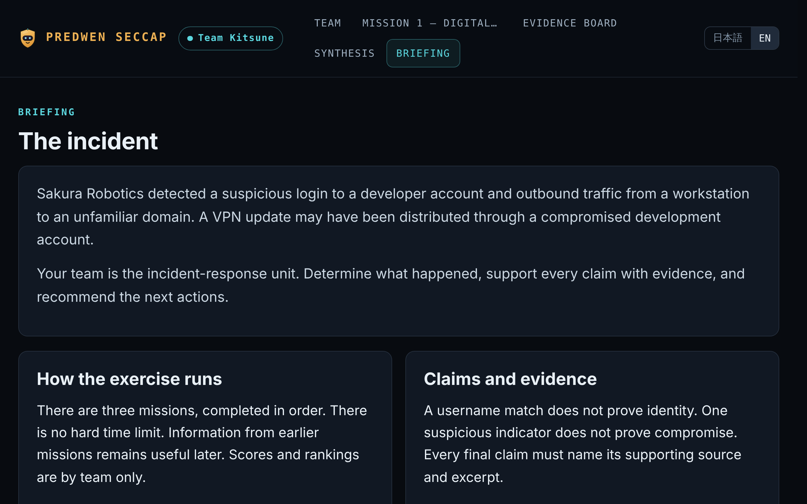
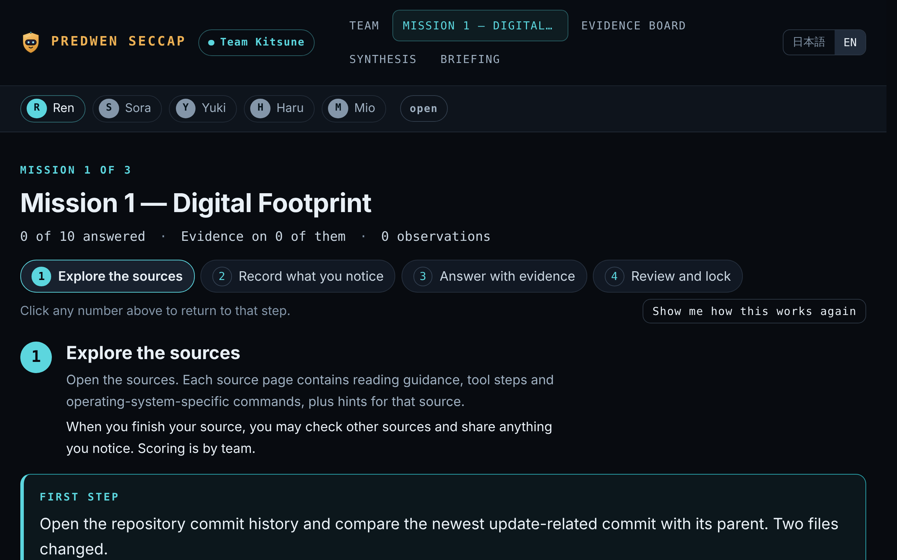
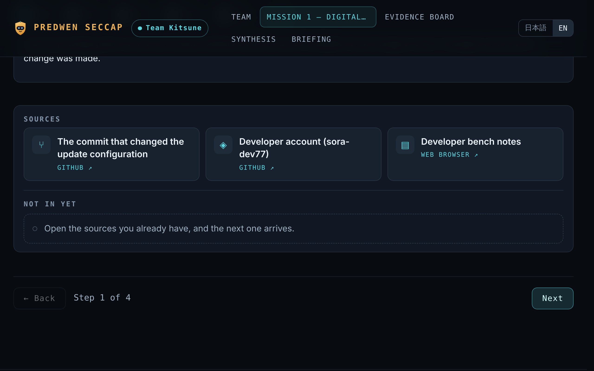
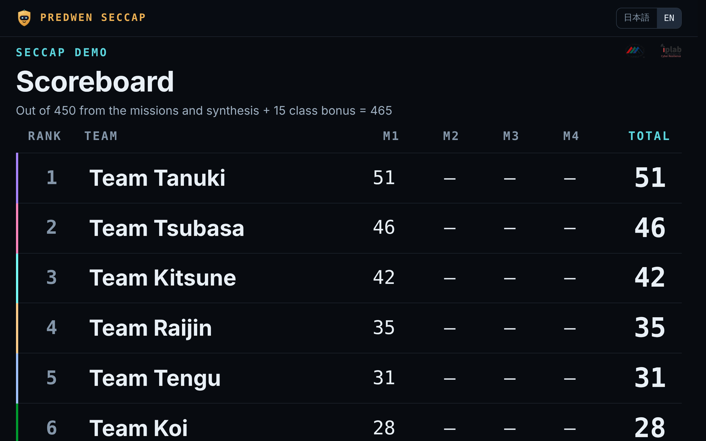
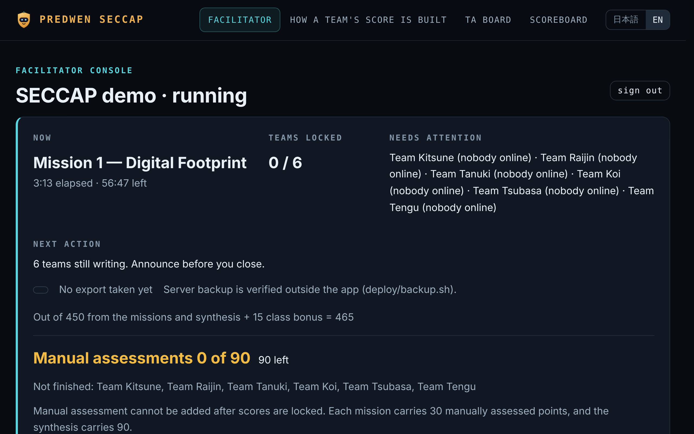
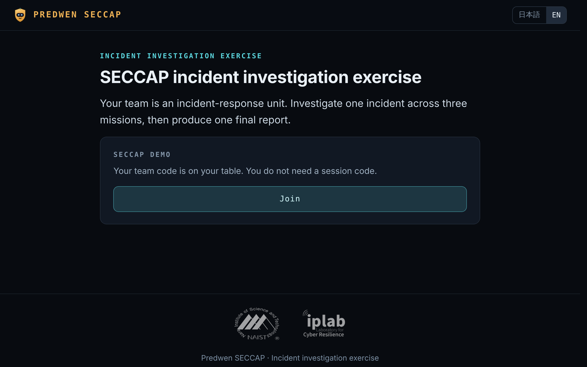
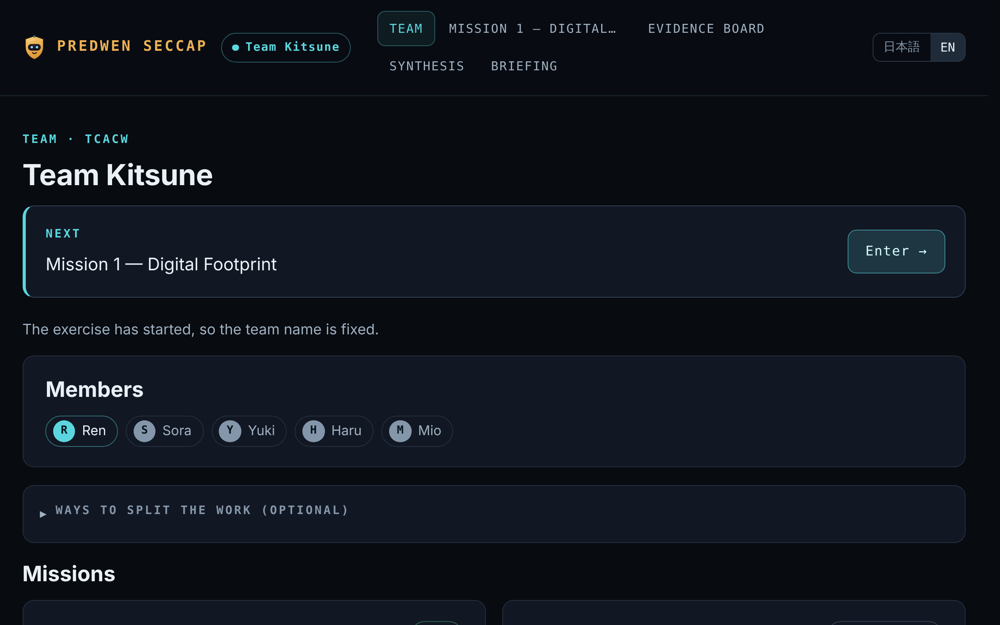
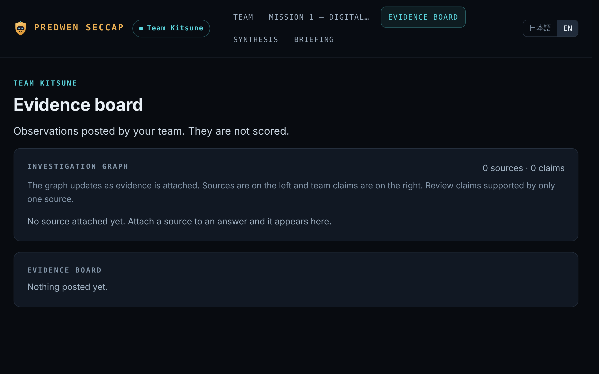

<div align="center">


# Predwen SECCAP

**A team incident-response exercise for the classroom.**<br>
Six teams, one breach, four missions. Every answer needs evidence.




</div>

## The incident

Sakura Robotics sees a suspicious login on a developer account, then outbound traffic from a workstation to a domain nobody recognises. A VPN client update may have shipped through the compromised account.

Each team is the incident-response unit. They follow the trail from a public commit to the infrastructure behind the update, then into the endpoint evidence, and finish with a report they can defend in front of the class.

| | Mission | What teams work with | Points |
|---|---|---|---|
| 1 | **Digital Footprint** | commit history, a developer account, bench notes, a username collision | 100 |
| 2 | **Distribution Infrastructure** | RDAP, DNS, certificate logs, update headers, a CDN manifest | 100 |
| 3 | **Endpoint Analysis and Scoping** | process tree, PowerShell log, proxy log, persistence, sandbox report, MITRE ATT&CK | 100 |
| 4 | **Incident Report Synthesis** | timeline, verdict, scope and response plan, presented to the class | 150 |

35 questions and 26 sources in all. Everything in the story is invented: domains sit under `.test` and `.invalid`, addresses are private, and the "payload" is a text file that says so on its first line ([NOTICE.md](NOTICE.md)).

## How a session feels

<table>
<tr>
<td width="50%"></td>
<td width="50%"></td>
</tr>
<tr>
<td><sub><b>Four steps per mission.</b> Explore the sources, record what you notice, answer with evidence, review and lock.</sub></td>
<td><sub><b>Sources arrive in turn.</b> A team opens what it has, and the next source unlocks.</sub></td>
</tr>
<tr>
<td></td>
<td></td>
</tr>
<tr>
<td><sub><b>Projector scoreboard.</b> Per mission, shown or hidden by the facilitator.</sub></td>
<td><sub><b>Facilitator console.</b> What is running, who needs help, what to do next.</sub></td>
</tr>
</table>

<details>
<summary><b>More screens</b></summary>
<br>
 

</details>

## Design choices

- **Claims need sources.** An answer is linked to the sources that support it, and the evidence board draws the graph of sources and claims. A claim resting on a single source is flagged for a second look.
- **The team is the unit.** Only teams are scored. Members join with a team code and a nickname, nothing more.
- **Hints help, never punish.** Hints come in steps and cost no points, so a stuck team keeps moving.
- **The facilitator sets the pace.** Missions open when the facilitator opens them. Time targets are advisory and nothing closes on its own.
- **It runs offline.** Every web pivot in the story also ships as a local copy under `artifacts/`, and `validate_content.py` fails if one is missing. A room with no internet still gets the whole exercise.
- **Two languages.** Japanese by default, English one click away, for every screen and every source guide.

Also in the box: a collective intelligence board shared across teams, a TA board for manual assessment, the final report and presentation mode, and CSV and JSON exports.

## Run it

```bash
python -m venv .venv && . .venv/bin/activate
pip install -r requirements.txt
cp .env.example .env
```

Put a secret key and a facilitator password hash in `.env`:

```bash
python -c "import secrets; print(secrets.token_urlsafe(48))"
python -c "from werkzeug.security import generate_password_hash as g; print(g('choose-a-password'))"
```

Then seed a session and start:

```bash
python scripts/validate_content.py
python scripts/seed_demo.py --title "SECCAP rehearsal"
python wsgi.py
```

| Who | Where |
|---|---|
| Participants | <http://localhost:8000/join> |
| Facilitator | <http://localhost:8000/facilitator> |
| Projector | <http://localhost:8000/scoreboard?projector=1> |

`scripts/show_codes.py` prints the team codes to put on each table.

**With Docker**

```bash
cp .env.example .env
docker compose up -d --build
docker compose exec seccap python scripts/seed_demo.py
curl -s localhost:8000/healthz
```

The database lives in a Docker volume. Server scripts for a real event (backup, environment check) are in `deploy/`.

## Inside

Flask, SQLAlchemy and SQLite in WAL mode, Jinja templates and plain JavaScript. Missions are YAML files in `content/missions/`, interface text is in `content/ui.yaml`, and the evidence files are in `artifacts/`. Writing a new incident means writing new YAML and new files; the code stays the same.

```bash
python scripts/validate_content.py   # content, sources and translations
python -m pytest -q                  # 1442 tests
```

## Status

Built for SECCAP and complete. The exercise, content and tooling are finished and kept here as a working reference. Issues and forks are welcome.

<div align="center">
<br>

<br>
<sub>MIT · Laboratory for Cyber Resilience, Nara Institute of Science and Technology</sub>
</div>
